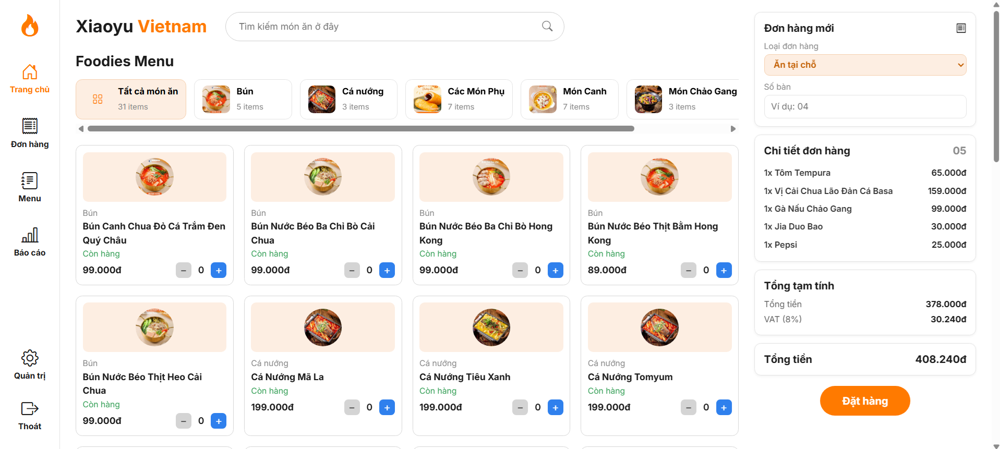
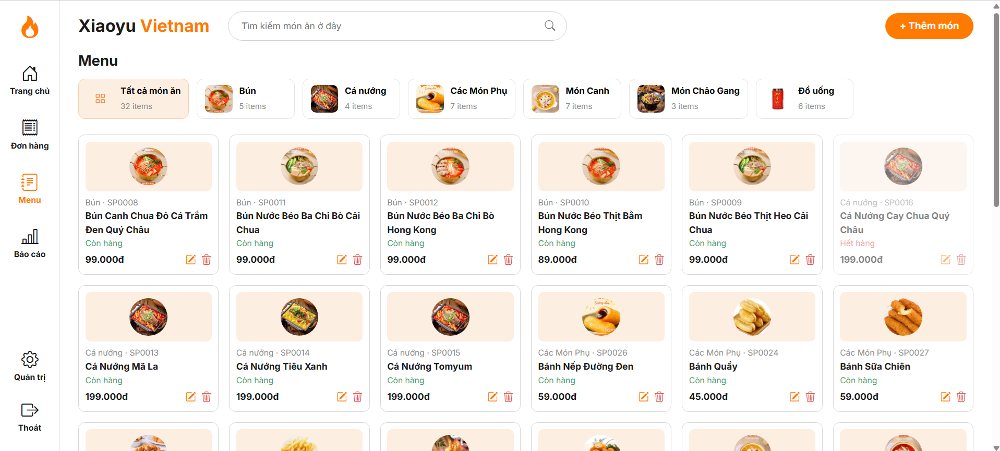
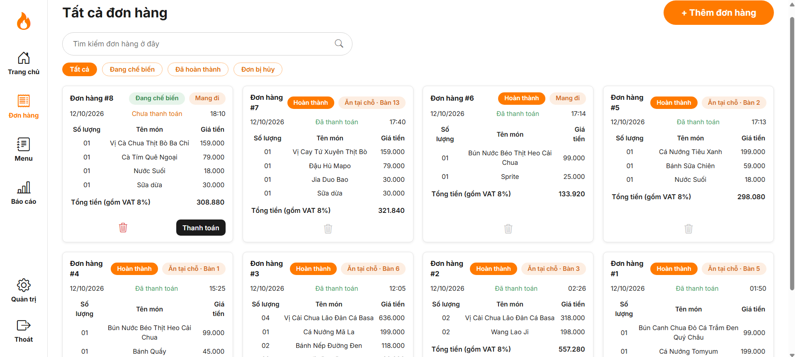
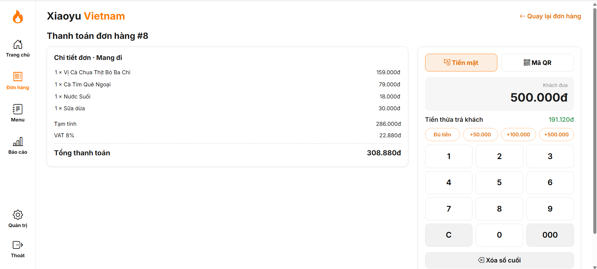
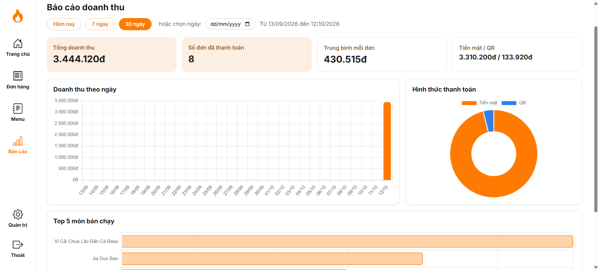

# Xiaoyu POS – Hệ thống bán hàng cho nhà hàng

Ứng dụng web quản lý bán hàng cho nhà hàng, xây dựng bằng Django.
Hỗ trợ gọi món, quản lý menu, đơn hàng, thanh toán tiền mặt/QR và báo cáo doanh thu.

## Tính năng
- Đăng nhập, đăng xuất
- Chọn món và quản lý giỏ hàng
- Quản lý menu (thêm, sửa, xóa món)
- Quản lý đơn hàng
- Thanh toán tiền mặt và QR, có bàn phím số
- Báo cáo doanh thu kèm biểu đồ, chỉ admin và cửa hàng trưởng được xem
- Phân quyền theo vai trò (admin, cửa hàng trưởng, thu ngân), giới hạn quyền xem báo cáo doanh thu
- Hiển thị tiền VND theo định dạng chuẩn (template filter `vnd`)

## Công nghệ
Python, Django, HTML/CSS/JavaScript, SQLite

## Ảnh chụp màn hình

| Đăng nhập | Trang chủ |
|---|---|
|  |  |

| Menu | Đơn hàng |
|---|---|
|  |  |

| Thanh toán | Báo cáo |
|---|---|
|  |  |

## Cách chạy
```bash
git clone https://github.com/NgcTrinh1102/pos-restaurant.git
cd pos-restaurant
python -m venv venv
venv\Scripts\activate
pip install -r requirements.txt
python manage.py migrate
python manage.py createsuperuser
python manage.py runserver
```
Mở http://127.0.0.1:8000

## Tác giả
Ngô Lê Ngọc Trinh – urchico204@gmail.com – [GitHub](https://github.com/NgcTrinh1102)